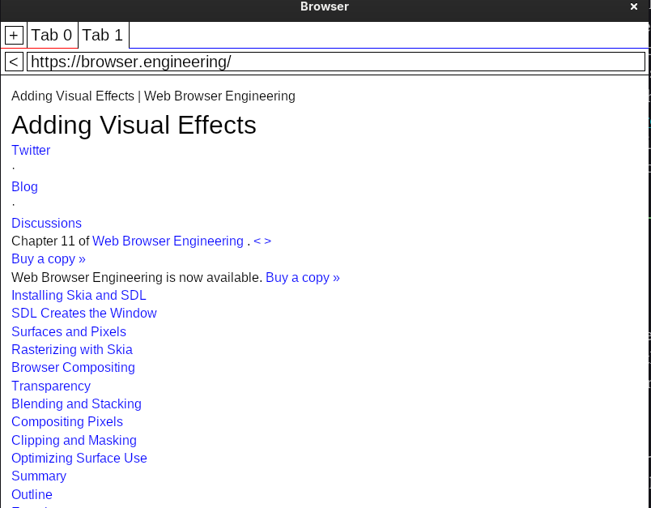
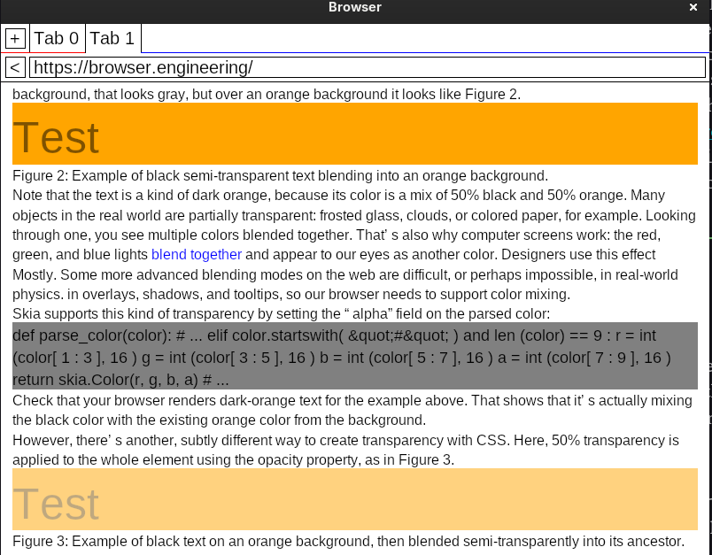
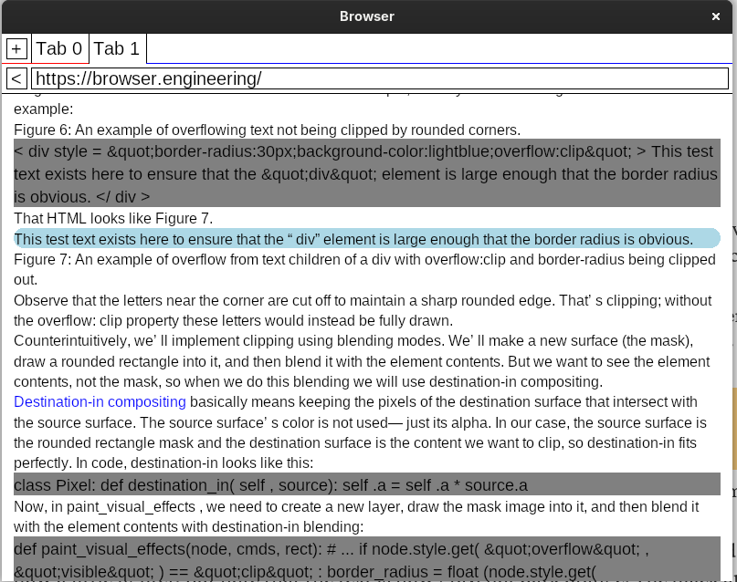
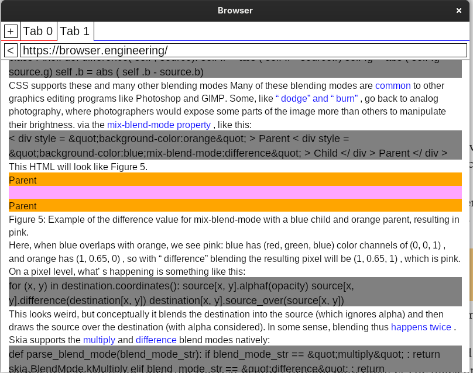

## An attempt at implementing the book [Web Browser Engineering](https://browser.engineering/) **_by Pavel Panchekha & Chris Harrelson_** in C++20

The original book's implementation is in Python.

> **NOTE:** inter chapter commits are done in the branch chpX-working. It's merged with master once I complete the chapter and the executable's functional!!

> I aim to have NO AI generated code in this repo. NOT ANTI-LLM, it's just for me to learn the language and how browsers work. It's still gonna be very sloppy cuz first C++ project but at least it's gonna be human slop!!

### Current Status (Latest Nov 14)

#### Chapter 11 - Completed (Nov 14 2026)

- All rasterizations are now done on Skia's surfaces and then copied to SDL's windows instead of being directly rendered in SDL.
- Chrome and Tabs are rastered seperatly based on actions performed there and then composited into the main surface and then presented into SDL window.
- Colours have their alpha values represented on the rendered frame with different CSS specific blending mode available for pixel compositing
- Clipping and masking implemented with destination in compositing

- Skia rendered Browser
  
  

- Alpha working chapter example:
  
  

- Text clipping:
  
  

- Difference blending:
  
  

### Requirements for anybody wanting to run it

(Only works on Linux for now)

- CMake >= 4.3.0
- C++23 capable compiler (remove instances of std::print/println usage to make it C++20 compilable)
- OpenSSL 3.5.7
- SDL3 and SDL3_ttf
- GCC >= 16.2.1
- Freetype2 >= 26.6.2
- Fontconfig >= 2.17.0

> NOTE: Duktape engine has been included with CMAKE and is under externals/

> NOTE: Skia is statically linked and requires freetype2 and Fontconfig to be dynamically linked for that to work. You can edit CMakeLists.txt itself if u wanna change how skia is linked

### Steps

- Fork the repo
- Clone it and get inside the directory

```
  git clone https://github.com/<your-username>/Browser.Engineering-in-Cpp
  cd Browser.Engineering-in-Cpp
```

- First build and run the server on port 8000:

```
 cd Server
 g++ -std=c++23 -o server riolib.cpp server.cpp
 ./server 8000
```

- Then build and run the Browser (in another terminal on project's root directory):

  ```
  cmake -B build
  cmake --build build
  cd build
  ./Browser
  ```

- The Browser will automatically take you to your localhost:8000, if you wanna navigate external websites (only <https://browser.engineering/> even works somewhat right now, anything else could most likely just crash the browser), just edit the link in the URL tab

### Next Step: Chapter 12

### Credits (Other Places I got some code from)

- Extremely helpful Skia-SDL combo examples, but most examples involve GPU rendering: [Skia-C-Examples](https://github.com/HinTak/skia-c-examples)
- The multi-byte utf-8 based word separator algorithm uses the DFA entirely copied from this text: [Flexible and Economical UTF-8 Decoder](https://bjoern.hoehrmann.de/utf-8/decoder/dfa/), I modified it a bit for my needs at include/UnicodeDecoder.hpp
- [Duktape](https://duktape.org/) and their example programs at their [Github](https://github.com/svaarala/duktape) were really helpful!
- The minimal Server inside Server/ is modified from the TINY Server Implementation in [CS:APP book](https://csapp.cs.cmu.edu/3e/students.html) Chapter 11: Network Programming
- include/rio.hpp and include/rio.cpp is also modified version of the Robust Input Output (RIO) library implemented in [CS:APP book](https://csapp.cs.cmu.edu/3e/students.html) Chapter 10 System-Level I/O
- The percentage encoding/decoding implemented here (at include/url.hpp and server/riolib.hpp) are taken and somewhat modified from here [Github](https://github.com/gofer/percent_encoding)
- The OpenSSL configuration for TLS handshake was almost entirely copied from [OpenSSL-TLS-Client-Block Guide](https://docs.openssl.org/master/man7/ossl-guide-tls-client-block/#setting-the-servers-hostname)
