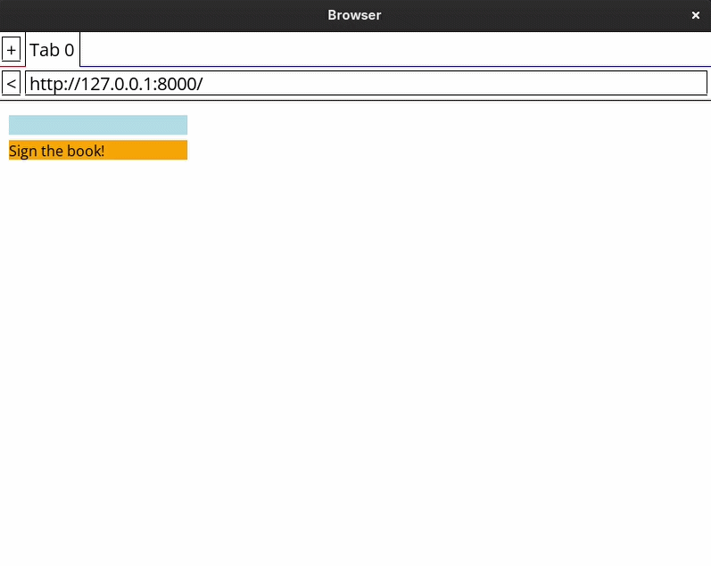

## An attempt at implementing the book [Web Browser Engineering](https://browser.engineering/) **_by Pavel Panchekha & Chris Harrelson_** in C++20

The original book's implementation is in python.

> **NOTE:** inter chapter commits are done in the branch chpX-working. It's merged with master once I complete the chapter and the executable's functional!!

> This is a learning project, basically my first C++ project after doing learncpp. So probably uses a lot of things that are not best practices.

> I aim to have as little AI generated code as possible in this repo. NOT ANTI-LLM, it's just for me to learn the language and how browsers work.

### Current Status (Latest Oct 12)

#### Chapter 8 - Completed (Oct 12 2026)

- Supports basic POST requests.
- Server/ directory had a minimal static server to test the Browser
- Supports HTML Form as well as Input and Buttom Widgets
- Supports Percentage Encoding/Decoding, not completly but it's self-implemented so works mostly

- Minimal POST request demo:
  

### Requirements for anybody wanting to run it

- CMake >= 4.3.0
- C++20 capable compiler
- OpenSSL 3.5.7
- SDL3 and SDL3_ttf

### Steps (On Linux)

- Fork the repo
- Clone it and get inside the directory

```
  git clone https://github.com/<your-username>/Browser.Engineering-in-Cpp
  cd Browser.Engineering-in-Cpp
```

- First build and run the server on port 8000:

```
 cd Server
 g++ -std=c++20 -o server riolib.cpp server.cpp
 ./server 8000
```

- Then build and run the Browser (in another terminal on project's root directory):

  ```
  cmake -B build
  cmake --build build
  cd build
  ./Browser
  ```

- The Browser will automatically take you to your localhost:8000, if you wanna navigate external websites (only <https://browser.engineering/> even works somewhat right now, anything else could most likely just crash the browser), just edit the link in the URL tab

### Next Step: Chapter 9

### Credits (Other Places I got some codes from)

- The minimal Server inside Server/ is modified from the TINY Server Implementation in [CS:APP book](https://csapp.cs.cmu.edu/3e/students.html) Chapter 11: Network Programming
- include/rio.hpp and include/rio.cpp is also modified version of the Robust Input Output (RIO) library implemented in [CS:APP book](https://csapp.cs.cmu.edu/3e/students.html) Chapter 10 System-Level I/O
- The percentage encoding/decoding implemented here (at include/url.hpp and server/riolib.hpp) are taken and somewhat modified from here [Github](https://github.com/gofer/percent_encoding)
- The OpenSSL configuration for TLS handshake was almost entirely copied from [OpenSSL-TLS-Client-Block Guide](https://docs.openssl.org/master/man7/ossl-guide-tls-client-block/#setting-the-servers-hostname)
- The multibyte character parsing algorithm at src/BlockLayout.cpp was heavily AI Assisted [Gemini](https://gemini.google.com)
